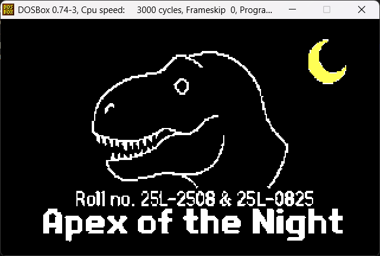
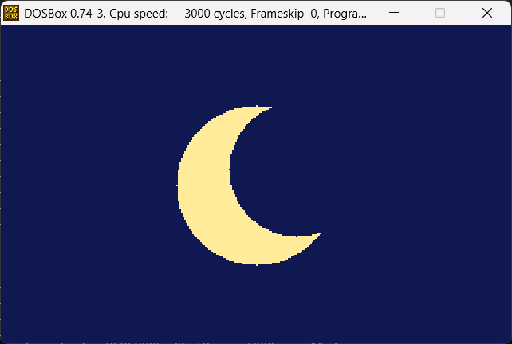
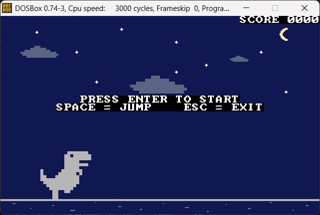
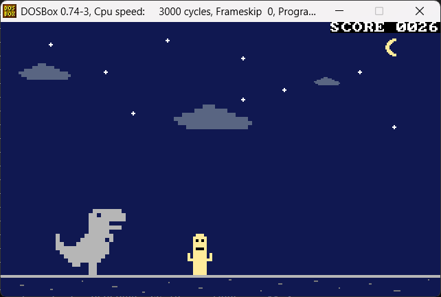

# Dino: The Night Rex

An 8-bit dinosaur runner game built from scratch in **16-bit x86 NASM assembly** for **DOSBox**, created as my Computer Organization and Assembly Language (COAL) semester project.

## Screenshots

| Intro Screen | Gameplay |
| :---: | :---: |
|  |  |

| Obstacles | Game Over |
| :---: | :---: |
|  |  |

## What's Inside
* **VGA Mode `0x13` Graphics (`320x200`, 256 colors):** Hand-crafted pixel sprites, animated running frames, moving obstacles, and a binary intro title screen loaded from `intro.bin`.
* **Smooth Timing & Physics:** Uses a custom PIT timer interrupt (`~100 Hz`) for game speed and scoring, paired with VGA vertical retrace sync (`port 0x3DA`) so animations don't tear or flicker.
* **PC Speaker Audio:** Generates retro chiptune sound effects and notes directly through the hardware speaker ports (`0x42`, `0x43`, and `0x61`).

## How to Run It
You'll need **NASM** and **DOSBox** installed.

1. Open DOSBox and mount the folder where you cloned/downloaded the repo:
   ```bat
   mount c D:\FAST_Uni_Docs\Dino_Game_Assembly
   c: